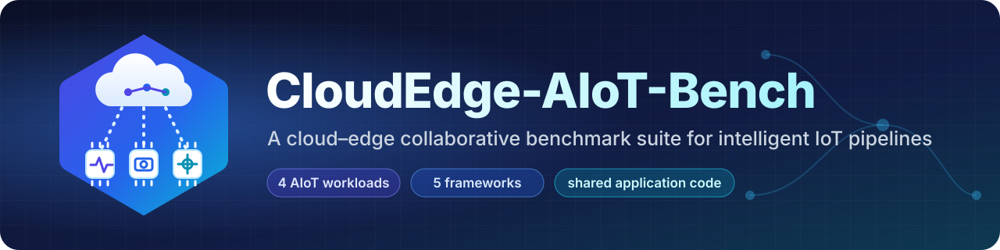
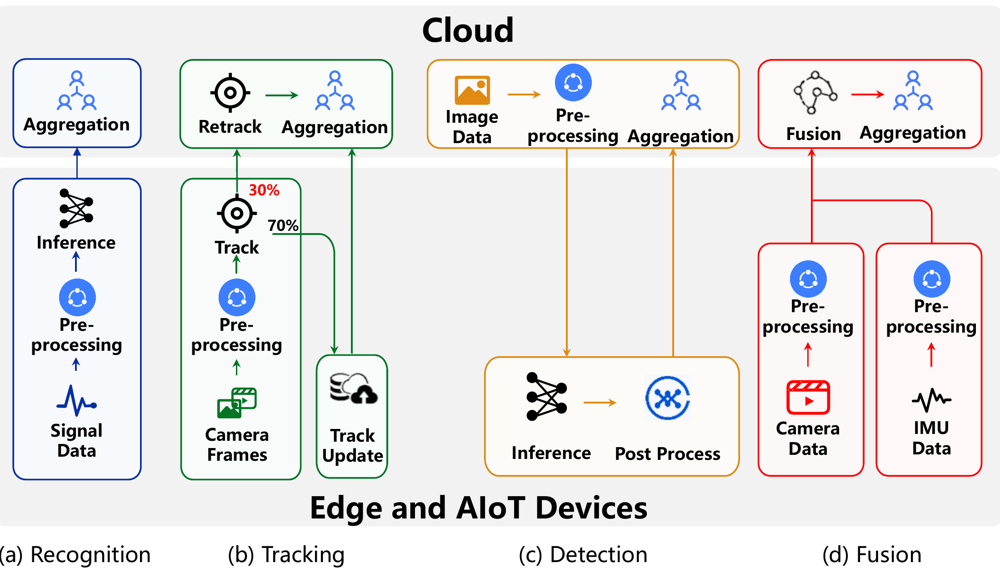

<p align="center">
  
</p>

<p align="center">
  <a href="LICENSE"></a>
  
  
  
  
</p>

<p align="center">
  <b>Four repeatedly triggered cloud–edge AIoT pipelines, each written once as plain application code<br>
  and deployed on five programming / orchestration frameworks.</b>
</p>

<p align="center">
  <a href="#-workloads">Workloads</a> ·
  <a href="#-frameworks">Frameworks</a> ·
  <a href="#-lines-of-code">Lines of code</a> ·
  <a href="#-repository-layout">Layout</a> ·
  <a href="#-getting-started">Getting started</a> ·
  <a href="#-citation">Citation</a>
</p>

---

## ✨ Overview

Intelligent IoT applications increasingly run as **multi-stage pipelines that span cloud servers and
heterogeneous edge devices**: sensing and pre-processing sit next to the data, inference runs wherever
compute and latency allow, and aggregation closes the loop in the cloud. The same pipeline is triggered
again and again, by every new frame, window or sensor reading.

**CloudEdge-AIoT-Bench** packages four such pipelines as a reusable benchmark suite. It accompanies the
SenSys '27 paper *Hedices: A Cloud-Edge Collaborative Programming and Deployment Framework for
Intelligent IoT Applications*:

- 🧩 **One application, five frameworks.** The models, preprocessing, inference and post-processing of
  each workload live in [`apps/common/`](apps/common) and are imported verbatim by every implementation.
  Only the framework-specific glue differs.
- ⚖️ **Like-for-like baselines.** Every implementation provides the same runtime behavior: tier
  placement with per-stage CPU/memory demand, resident models, per-device concurrency with bounded
  native threads, code and dependency shipping, failure recovery, and a driver that keeps several
  pipeline instances in flight.
- 📏 **Reproducible programmability numbers.** [`tools/app_loc.py`](tools/app_loc.py) recomputes the
  paper's lines-of-code table from the sources in this repository.
- 🛰️ **Edge-to-cloud by construction.** Each stage declares the tier it runs on (`edge` or `cloud`),
  so the four pipelines exercise different cloud–edge splits, fan-ins and data paths.

<p align="center">
  
  <br>
  <sub><b>Figure 1.</b> Four typical intelligent IoT applications with different task deployments on cloud and edge.</sub>
</p>

## 🧪 Workloads

| | Workload | Input | Model | Pipeline stages |
|:-:|---|---|---|---|
| 🔌 | **W1 Recognition** | Household current trace ([UK-DALE](https://jack-kelly.com/data/)), 320-sample windows | 2-layer LSTM, on/off state of 15 appliances | signal decoding → window normalization → recognition → aggregation |
| 🎯 | **W2 Tracking** | 224×224 camera frames | YOLOX-nano (ONNX) | frame read → pre-processing → appearance tracking → {cloud re-detection (~30% of frames) ∥ edge track-table update (~70%)} → aggregation |
| 🖼️ | **W3 Detection** | 600×600 images | Faster R-CNN (ResNet-50; MobileNetV3-320 variant) | image load → pre-processing → inference → post-processing (box decoding + NMS) → aggregation |
| 🧭 | **W4 Fusion** | Camera frames + 6-axis IMU windows | YOLOX-nano + ~4 MB fusion CNN | {frame pre-processing → object detection} ∥ {IMU filtering} → multimodal fusion → aggregation |

W4 is the only workload with **two concurrent sensing branches that fan in** to a cloud-side model.
W2 has the deepest chain, and W3 has the heaviest single inference stage.

## 🧱 Frameworks

| Framework | Programming model | How stages are composed | Deployment artifacts |
|---|---|---|---|
| **Hedices** | `@Stem` stage functions + workflow function | traced into a DAG by the Stem | none (shipped by the runtime) |
| **Ray** | remote tasks + actors for resident models | object references | `runtime_env` |
| **Dask** | `client.submit` + `WorkerPlugin` | futures with explicit keys | `PipInstall`, `upload_file` |
| **KubeEdge** | one HTTP stage service per Deployment | driver chains service calls | per-runtime images, Deployments, Services |
| **Knative** | one HTTP stage service per Knative Service | driver chains service calls | per-runtime images, Knative Services |

> [!NOTE]
> The Hedices implementations are included so that the programmability comparison can be reproduced.
> They target the Hedices runtime, which is **not** part of this release.

## 📏 Lines of code

Non-blank, non-comment lines (Python docstrings count as comments), per workload. **Shared** is the
model, preprocessing and inference code that every implementation uses verbatim. Each framework column
counts the code and configuration specific to that framework, i.e., stage declarations, placement and
resource annotations, model residency and per-device concurrency, code shipping and failure handling,
pipeline composition, the invocation driver, service wrappers, and deployment manifests. A complete
application is **Shared** plus the framework column.

| Workload | Shared | **Hedices** | Ray | Dask | KubeEdge | Knative |
|---|--:|--:|--:|--:|--:|--:|
| W1 Recognition | 68 | **28** | 43 | 42 | 212 | 150 |
| W2 Tracking | 126 | **37** | 49 | 48 | 297 | 205 |
| W3 Detection | 106 | **31** | 47 | 46 | 255 | 178 |
| W4 Fusion | 125 | **33** | 51 | 49 | 261 | 182 |

```bash
python tools/app_loc.py                       # print the table
python tools/app_loc.py --csv loc.csv --tex loc_rows.tex
```

One-time cluster setup that every system needs (node tier labels and resources, cluster
installation) is excluded uniformly.

## 🗂️ Repository layout

```text
CloudEdge-AIoT-Bench/
├── apps/
│   ├── common/            # shared application code: data sources, models, pre/post-processing
│   │   ├── assets.py      #   node-local assets, loaded once per process
│   │   ├── yolox.py       #   YOLOX-nano helpers (W2, W4)
│   │   └── w1.py … w4.py
│   ├── hedices/w1.py … w4.py
│   ├── ray/w1.py … w4.py
│   ├── dask/w1.py … w4.py
│   ├── kubeedge/w1 … w4/  # stages.py · pipeline.py · Dockerfile · deploy.yaml
│   └── knative/w1 … w4/   # stages.py · pipeline.py · Dockerfile · service.yaml
├── tools/
│   ├── app_loc.py         # lines-of-code table
│   └── gen_k8s.py         # generates the KubeEdge / Knative manifests and Dockerfiles
└── docs/                  # logo, banner, Figure 1
```

## 🚀 Getting started

**1. Assets.** Model weights and datasets are not redistributed. Place them in `assets/` at the
repository root, or point `HEDICES_ASSETS` to another directory:

| File | Used by | Source |
|---|---|---|
| `w1/TotalCurrent.npy` | W1 | aggregate current windows derived from UK-DALE |
| `pics40.npz` (`img` array of RGB frames) | W2, W3, W4 | any set of RGB frames |
| `yoloxna-320.onnx` | W2, W4 | YOLOX-nano ONNX export from [YOLOX](https://github.com/Megvii-BaseDetection/YOLOX) |
| `script_model_cpu.pt` | W3 (ResNet-50) | TorchScript Faster R-CNN; `HEDICES_W3_MODEL=mobilenet` selects the torchvision MobileNetV3-320 variant instead |

Networks without a checkpoint are instantiated from a fixed seed, so every framework computes the
same outputs.

**2. Tier labels.** Every framework places stages by tier, so label your nodes once:

```bash
ray start ... --resources='{"edge": 1}'                       # or {"cloud": 1}
dask worker ... --resources "edge=1 CPU=4 MEM=8e9"            # or cloud=1
kubectl label node <node> hedices.io/tier=edge                # or cloud
```

**3. Run a workload.**

```bash
pip install numpy pillow onnxruntime torch torchvision

python -m apps.ray.w4                                          # Ray
python -m apps.dask.w4                                         # Dask (DASK_SCHEDULER_ADDRESS)

docker build --target onnx  -t aiot-bench/w4-onnx  -f apps/kubeedge/w4/Dockerfile .
kubectl apply -f apps/kubeedge/w4/deploy.yaml && python -m apps.kubeedge.w4.pipeline    # KubeEdge
kubectl apply -f apps/knative/w4/service.yaml  && python -m apps.knative.w4.pipeline    # Knative
```

Knative services use `nodeSelector` and `tolerations`, which require the
`kubernetes.podspec-nodeselector` and `kubernetes.podspec-tolerations` feature flags. The stage URLs
of the KubeEdge / Knative drivers can be overridden with `<STAGE>_URL` environment variables.

## 📚 Citation

If you use this benchmark suite, please cite:

```bibtex
@inproceedings{hedices2027sensys,
  title     = {Hedices: A Cloud-Edge Collaborative Programming and Deployment Framework for Intelligent IoT Applications},
  booktitle = {Proceedings of the ACM Conference on Embedded Networked Sensor Systems (SenSys '27)},
  year      = {2027}
}
```

## 📄 License

Released under the [Apache License 2.0](LICENSE).
